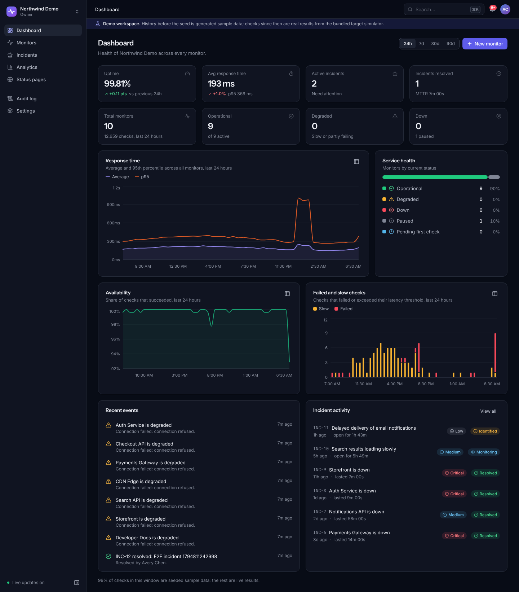
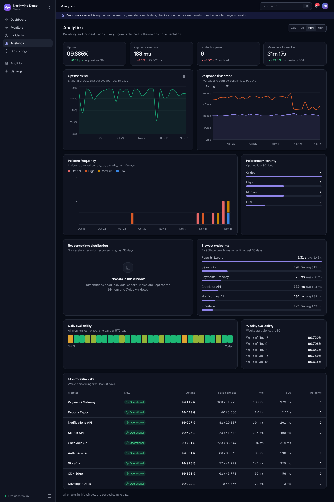
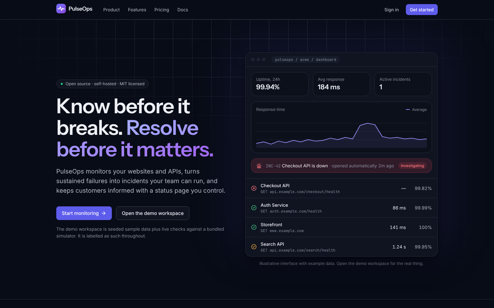
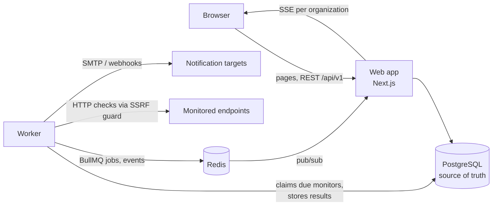

# PulseOps

**Know before it breaks. Resolve before it matters.**

PulseOps is a multi-tenant uptime monitoring and incident management platform. It checks your websites and APIs, turns sustained failures into incidents your team can run, notifies the right people once, and publishes a status page you control.

It is a complete, self-hostable application: a Next.js web app, a dedicated monitoring worker, PostgreSQL, and Redis.



| | |
|---|---|
|  |  |
|  |  |
|  |  |

Screenshots show the seeded demo workspace, which is sample data and labelled as such in the UI.

## Features

**Monitoring**
- Real HTTP checks (GET, HEAD, POST, OPTIONS) at intervals from 30 seconds, run by a separate worker process
- Timeouts, in-check retries, expected status codes, redirect handling, and DNS / connect / TLS / first-byte timings
- Failure and recovery thresholds, plus a degraded state for slow responses
- SSRF protection: private, loopback, link-local, and metadata addresses are refused, with DNS-pinned connections and per-redirect re-validation
- A test button that runs one real check before you save

**Incidents**
- Opened automatically when a monitor crosses its failure threshold, with no duplicates while it stays down; resolved automatically on sustained recovery (optional)
- Manual incidents, four statuses, four severities, owner assignment, linked monitors
- A timeline of updates, internal notes kept in a separate table, and field-level activity history

**Visibility**
- Live dashboard and per-monitor pages, updated over Server-Sent Events
- Analytics across 24 hours to 90 days: uptime, latency percentiles, incident frequency, time to resolve, worst performers
- Charts with documented formulas, a table view for each, and no dual axes

**Communication**
- Public status pages with public component names, uptime history, and incident notices
- Email (SMTP) and HMAC-signed webhook notifications through a transactional outbox, with retries, deduplication, a per-destination ceiling, and a delivery log

**Platform**
- Organizations with owner / admin / member / viewer roles, single-use invitations, and server-enforced tenant isolation
- Revocable server-side sessions, argon2id passwords, CSRF checks, rate limiting, an append-only audit log
- Optional AI incident assistant (Anthropic), off by default, working from sanitized aggregates
- Dark and light themes, command palette, keyboard shortcuts, responsive down to a phone

## Architecture



- **Postgres is the source of truth.** Each monitor's schedule is a `nextCheckAt` column; workers claim due rows with `FOR UPDATE SKIP LOCKED`. Redis only executes work, so it holds nothing durable.
- **The worker is a separate, long-running process.** It is not a serverless cron job.
- **Route handler → service → Prisma.** Services take a tenant context that can only be obtained by proving membership, and scope every query by it.
- **Real-time events are invalidation signals.** Data always travels through the authorized REST API.

More in [docs/architecture.md](docs/architecture.md) and the [decision records](docs/decisions).

## Tech stack

| Area | Choice |
|---|---|
| Framework | Next.js 16 (App Router, Cache Components), React 19, TypeScript (strict) |
| UI | Tailwind CSS 4, Radix primitives in the shadcn/ui style, Lucide, Recharts, cmdk, Sonner |
| Data | PostgreSQL 16, Prisma 7 (`@prisma/adapter-pg`) |
| Jobs and real time | Redis 7, BullMQ 6, Server-Sent Events |
| Client state | TanStack Query, React Hook Form, Zod 4 |
| Auth | First-party server-side sessions, argon2id |
| AI (optional) | Anthropic SDK behind a provider interface |
| Tests | Vitest, React Testing Library, Playwright |
| Ops | Docker, Docker Compose, GitHub Actions |

Two departures from the original brief, both deliberate: authentication is first-party rather than Auth.js ([ADR 1](docs/decisions/0001-first-party-sessions.md)), and Framer Motion is not used because CSS transitions covered every animation the interface needs.

## Quickstart with Docker

```bash
cp .env.example .env
docker compose up --build
```

Then open <http://localhost:3000/sign-in>.

| | |
|---|---|
| Email | `demo@northwind.example` |
| Password | `pulseops-demo-2026` |
| Other roles | `priya@` (admin), `marcus@` (member), `sofia@` (viewer), same password |
| Mail catcher | <http://localhost:8025> |
| Status page | <http://localhost:3000/status/northwind> |

Compose starts Postgres, Redis, the web app, the worker, a mail catcher, and a simulator of ten fictional services for the demo monitors to check. Migrations and the demo seed run automatically.

> The Compose stack was written and syntax-checked but could not be run in the environment this project was built in (no Docker daemon). The manual setup below is what was actually exercised. See [Known limitations](#known-limitations).

### Watch an outage happen

```bash
npm run demo:ctl -- break checkout-api 3   # fail for 3 minutes
npm run demo:ctl -- slow search-api 5      # respond slowly for 5 minutes
npm run demo:ctl -- status
```

Within about 90 seconds the monitor goes down, an incident opens, notifications are queued, and the dashboard updates without a reload. When the simulator heals, the monitor recovers and the incident resolves itself.

## Manual setup

Requires Node 22.12+, PostgreSQL 16, and Redis 7.

```bash
npm install                      # also generates the Prisma client
cp .env.example .env             # then edit DATABASE_URL / REDIS_URL if needed

createuser --pwprompt pulseops   # password: pulseops
createdb -O pulseops pulseops
createdb -O pulseops pulseops_test

npm run db:deploy                # apply migrations
npm run db:seed                  # load the demo workspace (optional)
npm run dev                      # web + worker + demo target simulator
```

`npm run dev` runs three processes. To run them separately: `npm run dev:web`, `npm run dev:worker`, `npm run demo:targets`.

## Environment variables

All variables are documented in [.env.example](.env.example) and validated at startup; an invalid value stops the process with a message naming it.

| Variable | Default | |
|---|---|---|
| `DATABASE_URL` | required | PostgreSQL connection string |
| `REDIS_URL` | `redis://localhost:6379` | |
| `APP_URL` | `http://localhost:3000` | Public origin; drives cookie security, CSRF, and email links |
| `ALLOW_SIGNUP` | `true` | `false` = invitation only |
| `MONITOR_ALLOWED_PRIVATE_HOSTS` | empty | Hosts exempt from the SSRF block. Demo and internal monitoring only |
| `CHECK_RETENTION_DAYS` | `30` | Raw check retention |
| `WORKER_CONCURRENCY` | `20` | Parallel checks per worker |
| `SMTP_URL` | unset | Without it, emails are recorded as "not sent" |
| `AI_PROVIDER` / `ANTHROPIC_API_KEY` | `none` / unset | Enables the AI assistant |

## Database

```bash
npm run db:migrate   # development: create and apply a migration
npm run db:deploy    # production: apply pending migrations
npm run db:seed      # demo workspace; idempotent, refuses to run in production
npm run db:reset     # drop, migrate, seed
```

Schema notes are in [docs/database.md](docs/database.md).

## Tests

```bash
npm run lint
npm run typecheck
npm test                 # 78 unit + 30 integration + 13 component tests
npm run build && npm run db:seed && npm run test:e2e   # 7 end-to-end tests
```

Integration tests use a real Postgres database (`pulseops_test`) and Redis database 9. End-to-end tests run the production build, the worker, and the simulator together.

What is covered: authentication and session revocation, sign-in lockout, CSRF, tenant isolation by slug and by id, role enforcement, monitor validation, the SSRF guard (URL policy, address classification, DNS rebinding, redirects), the HTTP checker against a live local server, the outage state machine, incident deduplication under concurrency, recovery and auto-resolution, notification idempotency, uptime maths, scheduler claiming, and status-page data leakage.

## Deployment

Run the web app, at least one worker, PostgreSQL 16, and Redis 7. Apply migrations before starting new code. The worker must run continuously; a platform that only runs request-scoped functions can host the web app but not the worker.

Full guide and production checklist: [docs/deployment.md](docs/deployment.md).

## Security

- Passwords: argon2id. Sessions: opaque tokens, hashed at rest, revocable.
- Every API handler authenticates, resolves membership, and checks a permission on the server. Foreign records return 404.
- Outbound requests to user-supplied URLs go through a three-layer SSRF guard. Its limits are documented, not hidden.
- Public status pages are produced by one allowlisted query, with a test asserting private fields never appear.
- No secrets are committed. `.env` is git-ignored.

Details, threat model, and known limits: [docs/security.md](docs/security.md). To report a vulnerability, see [SECURITY.md](SECURITY.md).

## Documentation

| | |
|---|---|
| [Architecture](docs/architecture.md) | Processes, scheduling, the result pipeline, real time |
| [Database](docs/database.md) | Tables, indexes, deletion behaviour |
| [API reference](docs/api.md) | Conventions, endpoints, examples, webhook format |
| [Metrics](docs/metrics.md) | How every number is calculated |
| [Security](docs/security.md) | Controls and their limits |
| [Deployment](docs/deployment.md) | Running it in production |
| [Design system](docs/design-system.md) | Tokens, components, chart rules |
| [Decisions](docs/decisions) | Why it is built this way |

## Known limitations

- **Docker images and Compose are unverified.** They were written carefully and `docker compose config` passes, but they have not been built or run. Expect to fix small issues on first use.
- **Checks run from one location.** There is no multi-region probing or consensus, so a network problem near the worker looks like an outage.
- **Monitors cannot send custom headers or request bodies**, so endpoints that need authentication cannot be checked yet.
- **Uptime is check-based.** An outage shorter than the check interval can be missed.
- **Long-window percentiles are approximate** (weighted from daily rollups). Counts, uptime, and means are exact.
- **No email verification, password reset, MFA, or SSO.** Invitations are delivered as a link the inviter shares; they are not emailed.
- **No Slack, Discord, SMS, or paging integrations.** Webhooks are the integration point.
- **No API keys.** The REST API is authenticated by session cookie only.
- **No billing.** The pricing page is explicitly illustrative.
- **Publishing an incident publishes its title as written**, and automatic incidents are titled after the monitor's private name.
- **The AI assistant has not been run against the live API** from this codebase (no key was available). It typechecks against the SDK and its surrounding logic is tested; the disabled state is verified.
- The CSP allows inline scripts ([ADR 6](docs/decisions/0006-content-security-policy.md)).

## Roadmap

- Multi-region checks with quorum before declaring an outage
- Request headers and bodies, with encrypted secret storage
- Keyword and JSON assertions; TLS certificate expiry monitoring
- Scoped API keys and a published OpenAPI document
- Maintenance windows and scheduled status-page notices
- Slack and PagerDuty channels; on-call schedules and escalation
- Email verification, password reset, and TOTP
- Hourly rollups and partitioning for `MonitorCheck`

## License

[MIT](LICENSE)
