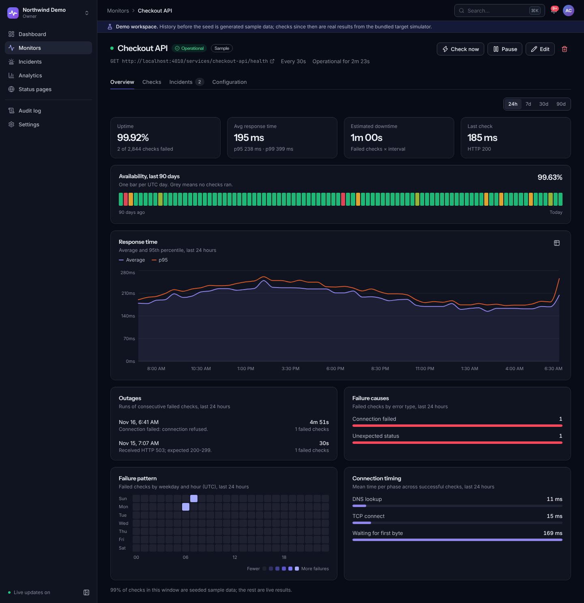
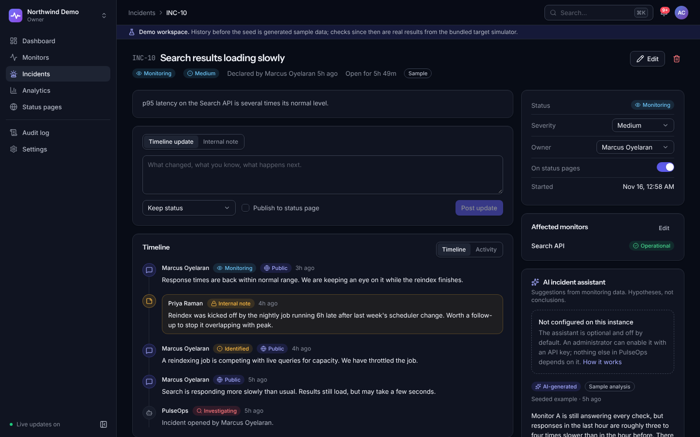
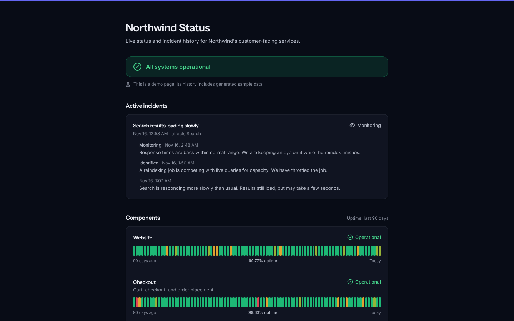
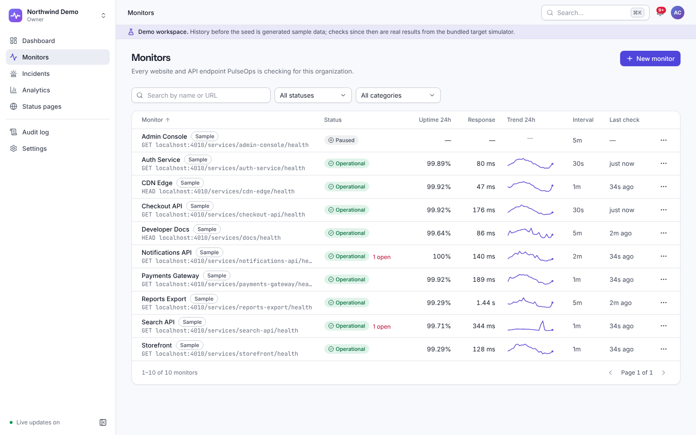
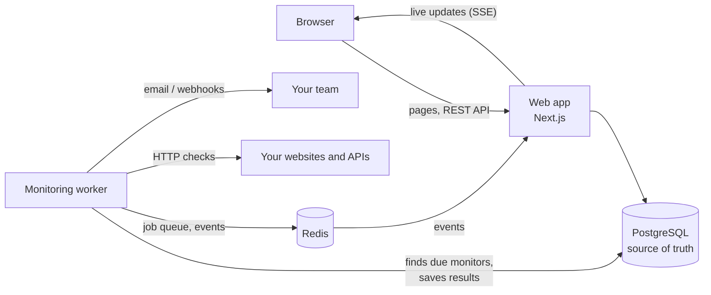

# PulseOps

**Know before it breaks. Resolve before it matters.**

PulseOps is a self-hostable platform for uptime monitoring and incident management. It checks your websites and APIs around the clock, turns sustained failures into incidents your team can work through together, notifies the right people once, and keeps customers informed with a public status page.

Designed and built by **[Nuhan Habib](https://github.com/nuhanhabib)**.


| | |
|---|---|
|  |  |
|  |  |
|  |  |

<sub>Screenshots show the built-in demo workspace. Its data is generated sample data and is labelled as such in the app.</sub>

## Contents

- [What it does](#what-it-does)
- [Getting started](#getting-started)
- [Configuration](#configuration)
- [How it works](#how-it-works)
- [Tech stack](#tech-stack)
- [Testing](#testing)
- [Deployment](#deployment)
- [Security](#security)
- [Documentation](#documentation)
- [Known limitations](#known-limitations)
- [Roadmap](#roadmap)
- [Author](#author)
- [License](#license)

## What it does

### Monitoring
- Real HTTP checks (GET, HEAD, POST, OPTIONS) from 30-second intervals, run by a dedicated worker process
- Timeouts, retries, expected status codes, and redirect handling
- DNS, connect, TLS, and time-to-first-byte timings on every check
- Failure and recovery thresholds, so a single blip never pages anyone
- A "degraded" state for endpoints that answer correctly but slowly
- A **Run test** button that performs one real check before you save
- Built-in protection against server-side request forgery (SSRF): private, internal, and cloud-metadata addresses are refused

### Incidents
- Opened automatically when a monitor stays down, with no duplicates while it remains down
- Resolved automatically when the service recovers (optional)
- Declared manually, with four statuses, four severities, an owner, and linked monitors
- A shared timeline of updates, plus internal notes that are never published

### Visibility
- A live dashboard and per-monitor pages that update without refreshing
- Analytics from 24 hours to 90 days: uptime, response-time percentiles, incident frequency, and time to resolve
- Every chart can be viewed as a table, and every formula is documented

### Communication
- Public status pages that show only the components and updates you choose
- Email (SMTP) and signed webhook notifications, with retries, deduplication, and a delivery log

### Teams and security
- Organizations with Owner, Admin, Member, and Viewer roles, and single-use invitation links
- Strict separation between organizations, enforced on the server
- Revocable sessions, argon2id password hashing, CSRF protection, rate limiting, and an audit log
- An optional AI incident assistant (Anthropic), off by default

### Experience
- Dark and light themes
- Command palette (`Ctrl+K` / `⌘K`) and keyboard shortcuts
- Responsive layouts from desktop down to phone

## Getting started

You can run PulseOps in two ways:

| | Best for | You need |
|---|---|---|
| **[Option 1: Docker](#option-1-docker)** | The quickest start; everything runs with one command | Docker Desktop |
| **[Option 2: Node.js, PostgreSQL and Redis](#option-2-nodejs-postgresql-and-redis)** | Running without Docker, or developing the code | Node.js 22, PostgreSQL 16, Redis 7 |

Both options load a **demo workspace**, so there is something to explore straight away.

### Option 1: Docker

```bash
git clone https://github.com/nuhanhabib/pulseops.git
cd pulseops
cp .env.example .env
docker compose up --build
```

This starts PostgreSQL, Redis, the web app, the monitoring worker, a local mail inbox for viewing notification emails, and a small simulator of demo services. The database is set up and the demo workspace is loaded automatically.

When it's running, open <http://localhost:3000/sign-in>. Notification emails appear at <http://localhost:8025>.

> **Note:** the Docker setup was prepared and its configuration checked, but it has not yet been run end to end. If you hit a problem, Option 2 is the fully tested path. Please [open an issue](https://github.com/nuhanhabib/pulseops/issues) so it can be fixed.

### Option 2: Node.js, PostgreSQL and Redis

Use this to run PulseOps directly on your computer without Docker.

**1. Install the requirements**

- [Node.js](https://nodejs.org/) 22.12 or later
- [PostgreSQL](https://www.postgresql.org/download/) 16 or later
- [Redis](https://redis.io/docs/latest/operate/oss_and_stack/install/) 7 or later. On Windows, use [Memurai](https://www.memurai.com/) (Redis-compatible) or run Redis through WSL.

Make sure PostgreSQL and Redis are running before you continue.

**2. Get the code and install dependencies**

```bash
git clone https://github.com/nuhanhabib/pulseops.git
cd pulseops
npm install
```

**3. Create the database**

Create a database user called `pulseops` with the password `pulseops`, then create two databases owned by it: `pulseops` for the app and `pulseops_test` for the tests.

```bash
createuser --pwprompt pulseops
createdb -O pulseops pulseops
createdb -O pulseops pulseops_test
```

If you prefer a graphical tool such as pgAdmin, create the same user and databases there.

**4. Configure the app**

```bash
cp .env.example .env
```

On Windows PowerShell, use `Copy-Item .env.example .env`.

The defaults work if PostgreSQL and Redis run on your computer with the user above. Otherwise, edit `DATABASE_URL` and `REDIS_URL` in `.env`.

**5. Set up the database and load the demo**

```bash
npm run db:deploy
npm run db:seed
```

**6. Start PulseOps**

```bash
npm run dev
```

This starts three processes together: the web app, the monitoring worker, and the demo service simulator. Open <http://localhost:3000/sign-in>.

### Demo sign-in

| | |
|---|---|
| Email | `demo@northwind.example` |
| Password | `pulseops-demo-2026` |
| Other roles | `priya@northwind.example` (Admin), `marcus@northwind.example` (Member), `sofia@northwind.example` (Viewer), same password |
| Public status page | <http://localhost:3000/status/northwind> |

You can also create your own account at <http://localhost:3000/sign-up>.

### Watch an outage happen

With PulseOps running, open a second terminal in the project folder:

```bash
npm run demo:ctl -- break checkout-api 3   # make a service fail for 3 minutes
npm run demo:ctl -- slow search-api 5      # make a service slow for 5 minutes
npm run demo:ctl -- status                 # see the state of every demo service
```

Within about 90 seconds the monitor goes down, an incident opens, notifications are sent, and the dashboard updates on its own. When the service comes back, the monitor recovers and the incident resolves itself.

### Troubleshooting

| Problem | Fix |
|---|---|
| "A required service (Redis) is not reachable" | Redis is not running. Start it, then try again. |
| Can't connect to the database | Check PostgreSQL is running and `DATABASE_URL` in `.env` is correct. |
| "Too many requests. Try again in …" | The sign-in or sign-up limit was reached. Wait for the time shown. |
| Port 3000 is already in use | Stop the other app using it, or run `npm run dev:web -- -p 3001`. |

## Configuration

Every setting is listed and explained in [`.env.example`](.env.example). Settings are checked when the app starts; if one is wrong, PulseOps stops and tells you which.

| Variable | Default | Purpose |
|---|---|---|
| `DATABASE_URL` | required | PostgreSQL connection string |
| `REDIS_URL` | `redis://localhost:6379` | Redis connection string |
| `APP_URL` | `http://localhost:3000` | The address people use to reach the app |
| `ALLOW_SIGNUP` | `true` | Set to `false` to allow sign-up by invitation only |
| `SMTP_URL` | not set | Mail server for notification emails. Without it, emails are logged but not sent. |
| `CHECK_RETENTION_DAYS` | `30` | How long individual check results are kept |
| `WORKER_CONCURRENCY` | `20` | How many checks one worker runs at once |
| `MONITOR_ALLOWED_PRIVATE_HOSTS` | empty | Private hosts monitors may reach. For the demo and internal monitoring only. |
| `AI_PROVIDER`, `ANTHROPIC_API_KEY` | `none` | Turn on the optional AI assistant |

## How it works



- **The web app** serves the interface, the REST API, and live updates.
- **The worker** is a separate, always-running process. It runs the checks, decides when something is down or has recovered, opens and resolves incidents, and sends notifications.
- **PostgreSQL** holds everything permanent, including each monitor's schedule.
- **Redis** runs the job queue and delivers live updates. It holds nothing that would be lost if it restarted.

The design decisions behind this are written up in [docs/architecture.md](docs/architecture.md) and the [decision records](docs/decisions).

## Tech stack

| Area | Technology |
|---|---|
| Framework | Next.js 16, React 19, TypeScript |
| Interface | Tailwind CSS 4, Radix UI, Lucide icons, Recharts |
| Database | PostgreSQL 16, Prisma 7 |
| Jobs and live updates | Redis 7, BullMQ, Server-Sent Events |
| Forms and data fetching | React Hook Form, Zod, TanStack Query |
| Authentication | Server-side sessions, argon2id |
| AI (optional) | Anthropic SDK |
| Testing | Vitest, React Testing Library, Playwright |
| Tooling | Docker, Docker Compose, GitHub Actions |

## Testing

```bash
npm run lint        # code style
npm run typecheck   # TypeScript
npm test            # 121 unit, integration, and component tests
```

End-to-end tests run the full application in a real browser:

```bash
npm run build
npm run db:seed
npm run test:e2e    # 7 end-to-end tests
```

Integration tests need PostgreSQL and Redis running, and use the separate `pulseops_test` database.

The tests cover sign-in and sessions, permissions for each role, separation between organizations, monitor validation, SSRF protection, real HTTP checks, outage detection and recovery, duplicate-free incidents, notification delivery rules, uptime calculations, and that public status pages never reveal private information.

## Deployment

PulseOps needs four things running: the web app, at least one worker, PostgreSQL, and Redis.

The worker must run continuously. Hosting that only runs short, request-based functions can host the web app but not the worker.

See [docs/deployment.md](docs/deployment.md) for the full guide and a production checklist.

## Security

- Passwords are hashed with argon2id; sessions can be revoked at any time.
- Every request is checked on the server for who is asking and what their role allows.
- One organization can never see another organization's data.
- URLs that users ask PulseOps to check are screened so they cannot reach private networks.
- Public status pages show only what has been explicitly published.
- No secrets are stored in the repository.

The details, including known limits, are in [docs/security.md](docs/security.md). To report a vulnerability, please follow [SECURITY.md](SECURITY.md).

## Documentation

| Document | What's inside |
|---|---|
| [Architecture](docs/architecture.md) | How the pieces fit together |
| [Database](docs/database.md) | Tables, indexes, and data rules |
| [API reference](docs/api.md) | Every endpoint, with examples |
| [Metrics](docs/metrics.md) | How each number is calculated |
| [Security](docs/security.md) | Protections and their limits |
| [Deployment](docs/deployment.md) | Running PulseOps in production |
| [Design system](docs/design-system.md) | Colours, components, and chart rules |
| [Decisions](docs/decisions) | Why it is built the way it is |

## Known limitations

- The Docker setup has not yet been run end to end.
- Checks run from a single location, so a network problem near the worker can look like an outage.
- Monitors cannot send custom headers or request bodies yet.
- Outages shorter than the check interval can be missed.
- There is no email verification, password reset, two-factor authentication, or single sign-on yet.
- Invitations are shared as a link rather than emailed.
- Slack, Discord, SMS, and paging integrations are not built in; webhooks can connect to them.
- The REST API uses session sign-in only; there are no API keys yet.
- The AI assistant has not been tested against the live AI service.
- The pricing page is illustrative; there is no billing.

## Roadmap

- Checks from multiple regions
- Custom request headers and bodies
- Keyword and JSON response checks, and TLS certificate expiry alerts
- API keys and an OpenAPI specification
- Maintenance windows on status pages
- Slack and PagerDuty integrations, on-call schedules
- Email verification, password reset, and two-factor authentication

## Contributing

Contributions are welcome. Please read [CONTRIBUTING.md](CONTRIBUTING.md) first.

## Author

**Nuhan Habib** designed and built PulseOps: architecture, backend, monitoring worker, interface, tests, and documentation.

- GitHub: [@nuhanhabib](https://github.com/nuhanhabib)

## License

[MIT](LICENSE) © 2026 Nuhan Habib
