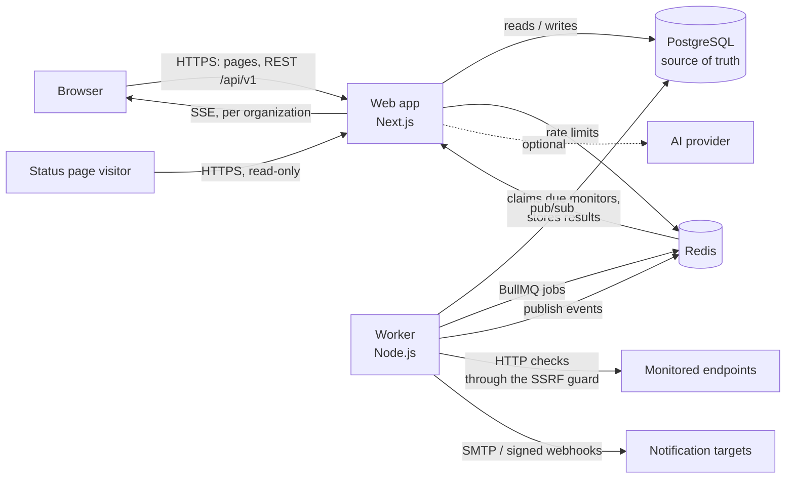

# Architecture

PulseOps is three processes and two data stores.



| Process | Entry point | Responsibility |
|---|---|---|
| Web | `next start` | UI, REST API, SSE stream, public status pages. Never runs scheduled work. |
| Worker | `src/worker/main.ts` | Scheduling, checks, the outage state machine, incident automation, notification delivery, rollups, retention. Long-running; one or more replicas. |
| Demo targets | `scripts/demo-targets.ts` | Development only. Simulates services to monitor. |

## Code layout

```
src/shared     isomorphic contract: enums, permissions, Zod schemas, DTO types, metric maths
src/server     env, db, redis, auth, http wrapper, monitoring engine, modules/<domain>
src/worker     scheduler, processors, outbox drain
src/app        routes: (marketing), (auth), org/[orgSlug], status/[slug], api/v1
src/components ui (design system), charts, layout, marketing
src/features   per-domain client components and hooks
```

ESLint enforces the boundaries: browser code cannot import server or worker modules (types excepted), and server code cannot import UI.

## Request path

`route.ts` → `orgRoute()` → service → Prisma.

`orgRoute` (in `src/server/http/handler.ts`) does the cross-cutting work once: request id, CSRF origin check, session lookup, membership lookup, permission check, rate limits, Zod validation of query and body, error mapping, and one structured log line per request. The handler it wraps receives an `OrgContext`.

Services take that `OrgContext` as their first argument, call `authorize(ctx, permission)` again, and scope every query by `ctx.organization.id`. Authorization therefore holds even if a service is called from somewhere other than HTTP. Services also own transactions, audit records, and real-time events.

Only DTOs from `src/shared/types.ts` leave a service. No Prisma model is serialized directly.

## Scheduling: Postgres decides what is due

Each monitor has a `nextCheckAt` column. Every `SCHEDULER_TICK_MS` the worker runs one statement that selects due monitors `FOR UPDATE SKIP LOCKED`, advances their `nextCheckAt`, and returns them. It then enqueues one BullMQ job per monitor.

Consequences:

- Creating, editing, pausing, or deleting a monitor is a single Postgres write. There is no second copy of the schedule in Redis to keep in sync.
- Any number of worker replicas can tick at once. `SKIP LOCKED` gives each due row to exactly one of them. No leader election.
- If Redis is wiped, nothing is lost: the next tick re-enqueues from Postgres.
- After worker downtime the schedule resumes from "now"; it does not replay a backlog of missed checks.

Jobs are enqueued with BullMQ deduplication keyed by monitor id, so at most one check per monitor is ever queued or running. A slow target cannot have overlapping checks.

**Tenant fairness.** The claim query ranks due monitors per organization and takes at most `SCHEDULER_MAX_PER_ORG` from each per tick, so one tenant with a huge backlog cannot starve the others. Every check has a hard timeout, so no job can hold a worker slot indefinitely. Job payloads carry the organization id and the processor queries by both ids.

## Applying a check result

`applyCheckResult` (`src/server/monitoring/process-result.ts`) runs one transaction:

1. `SELECT … FOR UPDATE` on the monitor row, by id **and** organization id.
2. Insert the `MonitorCheck`.
3. Run the pure state machine (`state-machine.ts`) to get the next status and transition.
4. Update the monitor's counters and status.
5. On `went_down` or `recovered`: write activity, enqueue notifications (outbox rows), and run incident automation.

The row lock serializes result processing per monitor. That is what makes "is there an open incident for this monitor? if not, create one" free of races. Real-time events are published after commit.

## Outage state machine

```
            success                      failures < threshold
  PENDING ─────────▶ UP ◀──────────────▶ DEGRADED
                      ▲   slow / fast      │ failures ≥ failureThreshold
                      │                    ▼
                      └──────────────── DOWN
                    successes ≥ recoveryThreshold
```

Two thresholds give hysteresis both ways: one failed check does not page anyone, and one lucky success mid-outage does not declare recovery.

## Incident automation

- **Down:** if any unresolved incident is already linked to the monitor (automated or manual), a system update is appended to it. Otherwise, if the monitor has `autoIncident`, a new incident is opened with the monitor's configured severity.
- **Recovered:** for each open incident linked to the monitor, a system update is appended. If the incident was opened by automation, the organization has auto-resolve on, and no other linked monitor is down, it is resolved. Incidents declared by people are never closed automatically.

## Notifications: transactional outbox

`enqueueNotifications` inserts `NotificationDelivery` rows inside the same transaction as the state change. A unique `(organizationId, dedupeKey)` index makes re-processing idempotent. The worker polls for `PENDING` rows and enqueues a BullMQ job per row (job id = row id). Delivery retries five times with exponential backoff; the row records attempts and the last error, and ends as `SENT`, `FAILED`, `SKIPPED` (no provider), or `SUPPRESSED` (hourly ceiling).

The web app never talks to BullMQ. It only writes Postgres rows.

## Real time

The worker and the web app publish thin events (`{type, ids}`) to a Redis channel per organization. `GET /api/v1/orgs/:slug/stream` authorizes the caller like any other route and then relays that organization's channel as Server-Sent Events. One Redis subscriber connection per web process fans out to all open streams.

The browser treats events as invalidation hints and refetches through the REST API, so access control stays in one place and a lost event costs freshness, not correctness. Streams close after ten minutes; the browser reconnects, which re-checks the session and membership. After a reconnect the client refetches everything, since events may have been missed.

## Rendering

Next.js 16 with Cache Components. Marketing pages are static. The organization layout renders a static skeleton, then resolves the session and membership inside a `<Suspense>` boundary. Pages beneath it are client components that fetch through TanStack Query. The public status page is server-rendered from an allowlisted query.

## Data retention

Raw checks are kept for `CHECK_RETENTION_DAYS` (default 30) and pruned hourly in batches. `MonitorDailyAggregate` keeps per-monitor, per-UTC-day rollups indefinitely; windows longer than 7 days read from it. The rollup job recomputes today and yesterday every five minutes and is idempotent.
